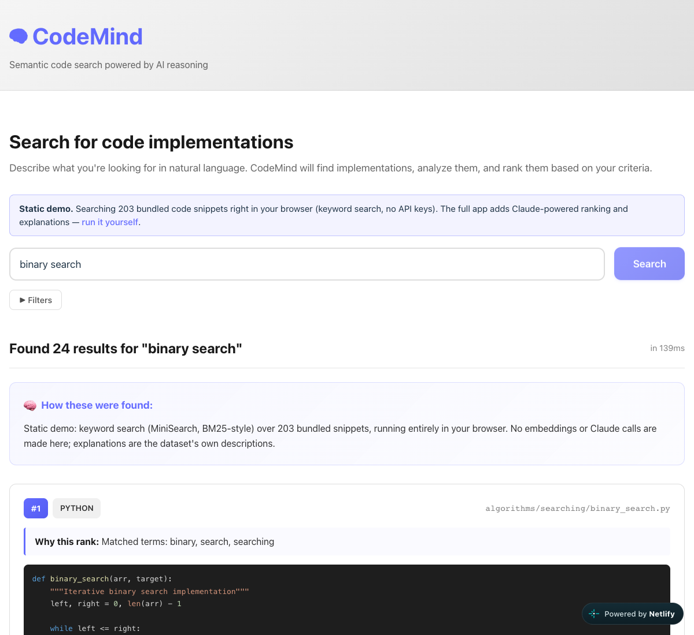

# CodeMind

**Describe the code you want in plain English, get matching implementations back, optionally ranked and explained by Claude.**

[](https://kush-codemind.netlify.app)
[](https://codespaces.new/KushagraKanaujia/codemind?quickstart=1)
[](LICENSE)




## Try it in one click

| Option | What you get | Needs |
| --- | --- | --- |
| **[Live demo](https://kush-codemind.netlify.app)** | The real UI, searching all 203 bundled snippets in your browser (keyword search). | Nothing |
| **[Open in Codespaces](https://codespaces.new/KushagraKanaujia/codemind?quickstart=1)** | The full app (FastAPI + React) starts by itself; the UI opens on port 5173, API docs on port 8000 `/docs`. | A GitHub account (Codespaces has a free monthly quota) |

No API keys are needed for either. Add your own keys (see below) to turn on Claude ranking.

## What it does

- **Search by intent.** Type something like `debounce function` or `jwt authentication middleware` and get matching snippets with syntax highlighting.
- **Filter by language.** Python, JavaScript, TypeScript, Java, C++, SQL.
- **Explain and rank (with keys).** In live mode the backend sends candidates to Claude, which ranks them against your criteria (`fast`, `readable`, `secure`, `simple`, `maintainable`) and explains each pick with a score breakdown.
- **Curated dataset.** `data/complete_dataset.json` holds 203 hand-picked snippets across algorithms, data structures, web development, system design, testing, utilities and best practices, each with a description and tags.

## How it works

The UI has three search modes, picked with `VITE_SEARCH_MODE`:

| Mode | Where results come from | Keys |
| --- | --- | --- |
| `browser` (live demo) | [MiniSearch](https://github.com/lucaong/minisearch) builds a full-text index of the dataset in the browser. It ranks hits BM25-style with prefix and fuzzy matching, weighting description over tags, path and code. | None |
| `demo` (default for local/Codespaces) | Backend `POST /api/v1/demo/search` returns fixed example results. If the API isn't running, it falls back to `browser`. | None |
| `live` | Backend `POST /api/v1/search/`: candidate snippets go to Claude (`ClaudeService.rank_code_results`), which returns a ranking, explanations and per-criterion scores as JSON. | Anthropic + OpenAI |

> **Status:** the embedding and pgvector parts (`VectorService`, `backend/scripts/index_code_data.py`, [docs/EMBEDDINGS.md](docs/EMBEDDINGS.md)) are written but not yet wired into `/search`. The live endpoint currently ranks a small built-in candidate set, and the testing-agent half of the project is still on the roadmap.

```
React UI (Vite) ──► /api/v1/demo/search   canned results, no keys
     │          └─► /api/v1/search/       Claude ranking (needs keys)
     └─► MiniSearch in the browser over data/complete_dataset.json (static demo / fallback)
```

## Tech stack

- **Frontend:** React 18, TypeScript, Vite, react-syntax-highlighter, MiniSearch
- **Backend:** FastAPI, Pydantic v2, Loguru
- **AI (optional):** Anthropic Claude for ranking, OpenAI `text-embedding-3-small` for embeddings
- **Planned storage:** Supabase pgvector, Redis cache

## Run locally

**Quick (no keys):**

```bash
git clone https://github.com/KushagraKanaujia/codemind && cd codemind
python3 -m venv .venv && source .venv/bin/activate
pip install -r backend/requirements-demo.txt
./scripts/dev.sh            # API on :8000, UI on http://localhost:5173
```

**Just the static demo:**

```bash
cd frontend && npm install
VITE_SEARCH_MODE=browser npm run dev
```

### Run the full app

```bash
pip install -r backend/requirements.txt
cp backend/.env.example backend/.env    # add ANTHROPIC_API_KEY, OPENAI_API_KEY (Supabase optional for now)
VITE_SEARCH_MODE=live ./scripts/dev.sh
```

More detail is in [GETTING_STARTED.md](GETTING_STARTED.md), [API_KEYS_SETUP.md](API_KEYS_SETUP.md), [DEMO_MODE.md](DEMO_MODE.md) and [docs/](docs/).

### Project layout

```
backend/app/
  api/demo.py           keyless demo endpoints
  api/search.py         Claude-ranked search
  services/             Claude + Supabase vector clients
frontend/src/
  services/api.ts       picks the search mode
  services/localSearch.ts  in-browser MiniSearch index
data/complete_dataset.json  203 curated snippets
.devcontainer/          one-click Codespaces setup
scripts/dev.sh          starts API + UI together
```

## Credits

- [MiniSearch](https://github.com/lucaong/minisearch) by Luca Ongaro (MIT): in-browser full-text search for the static demo
- [Dev Container images and features](https://github.com/devcontainers) (MIT): Python 3.11 + Node 20 Codespaces setup
- [react-syntax-highlighter](https://github.com/react-syntax-highlighter/react-syntax-highlighter) (MIT), [shields.io](https://shields.io) badges (CC0)
- Static demo hosted on Netlify's free tier

## License

[MIT](LICENSE) © Kushagra Kanaujia
